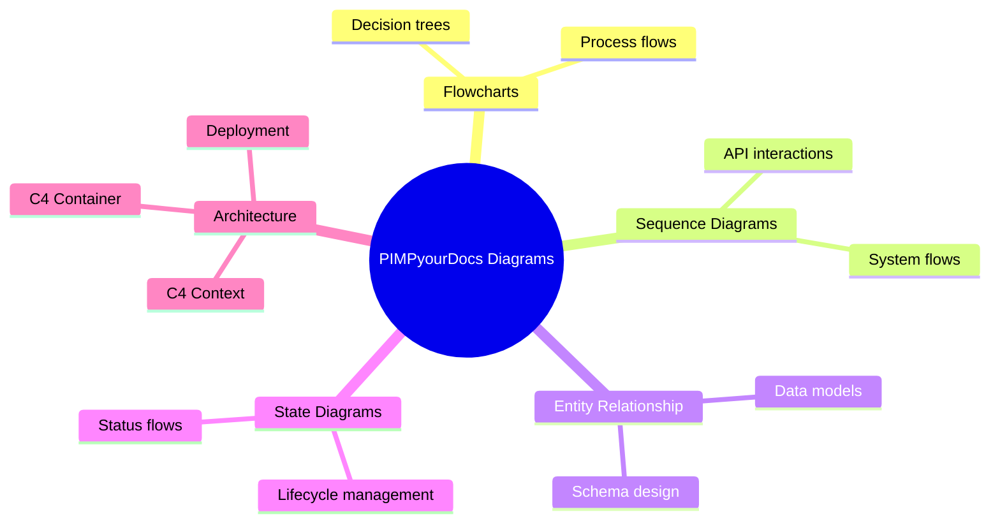
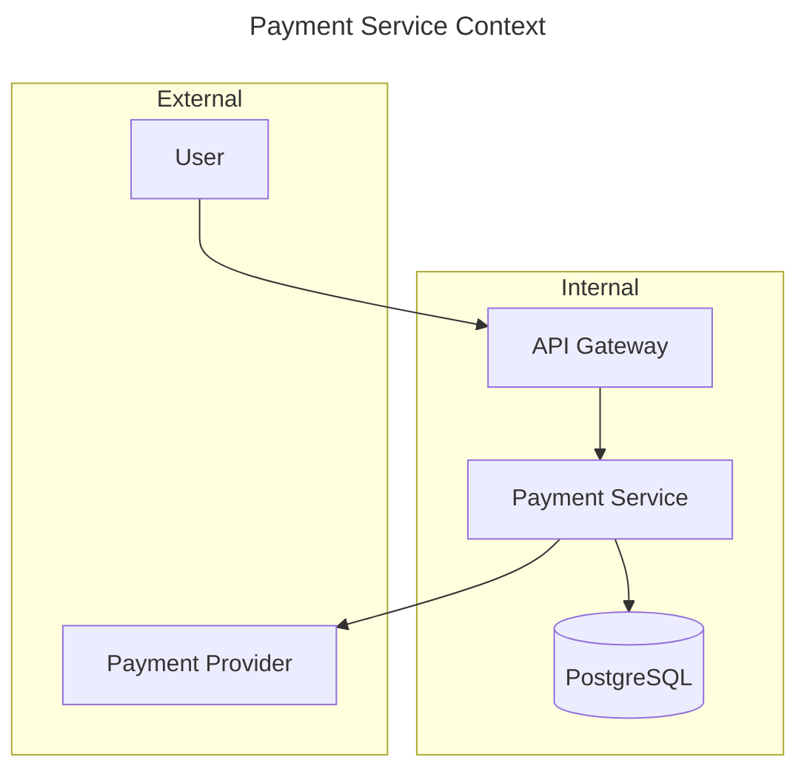
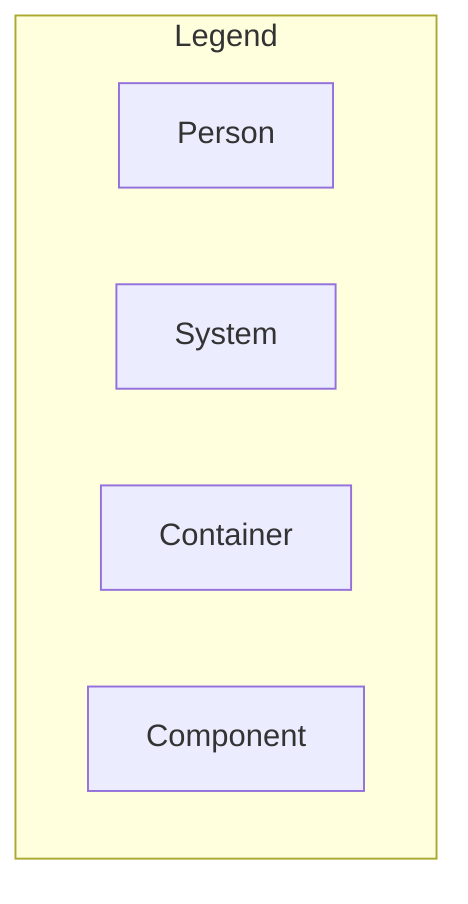

# PIMPyourDocs Specification

**Version:** 1.0.0  
**Status:** Living Document

---

## 1. Document Structure

### 1.1 File Naming

```
kebab-case-names.md
```

- Lowercase only
- Hyphens for spaces
- `.md` extension always
- No spaces, no underscores, no special characters

**Why:** Maximum filesystem compatibility. Works on case-sensitive and case-insensitive systems. URL-safe.

### 1.2 Directory Structure

```
docs/
├── index.md              # Entry point
├── architecture/         # System design & decisions
│   ├── index.md
│   └── decisions/        # ADRs live here
│       └── 0001-use-postgres.md
├── services/             # Per-service documentation
│   └── {service-name}/
│       ├── index.md
│       ├── api.md
│       └── runbook.md
├── operations/           # Operational documentation
│   ├── runbooks/
│   └── incidents/
└── guides/               # How-to guides
    └── ...
```

### 1.3 Required Front Matter

Every document MUST begin with a YAML front matter block:

```yaml
---
title: Document Title
status: draft | review | published | deprecated
owner: team-name or @username
created: YYYY-MM-DD
updated: YYYY-MM-DD
tags: [tag1, tag2]
---
```

**Why:** Machine-parseable metadata enables automation, search, and staleness detection.

---

## 2. Spec as Code

### 2.1 The Principle

Documentation describes the *intended state*—the specification—not the current state.

```
❌ "The service currently uses PostgreSQL 14"
✅ "The service MUST use PostgreSQL 14.x"
```

### 2.2 RFC 2119 Keywords

Use RFC 2119 keywords for requirements:

| Keyword | Meaning |
|---------|---------|
| MUST | Absolute requirement |
| MUST NOT | Absolute prohibition |
| SHOULD | Recommended, but exceptions exist |
| SHOULD NOT | Not recommended, but exceptions exist |
| MAY | Optional |

**Example:**

```markdown
## Authentication Requirements

- Clients MUST authenticate using OAuth 2.0
- Tokens SHOULD be refreshed before expiry
- Clients MAY cache tokens for up to 1 hour
```

### 2.3 Testable Documentation

Where possible, documentation should be testable:

```markdown
## API Contract

The `/health` endpoint MUST return:
- HTTP 200 when healthy
- Response time under 100ms
- JSON body: `{"status": "healthy"}`

<!-- test:api GET /health -->
```

These markers can be parsed by test harnesses to validate reality against spec.

### 2.4 Version Binding

Specifications should be version-bound:

```markdown
## Dependencies

| Component | Version | Constraint |
|-----------|---------|------------|
| PostgreSQL | 14.x | MUST match major version |
| Redis | 7.x | SHOULD use latest patch |
| Node.js | 20.x | MUST use LTS |
```

---

## 3. Diagrams as Code

### 3.1 Mermaid Only

All diagrams MUST be Mermaid. No external image files for architectural diagrams.

**Why:**

- Version controlled with the doc
- Diff-able
- No binary blobs in git
- Renders anywhere Mermaid is supported (GitHub, GitLab, VS Code, Obsidian, etc.)

### 3.2 Supported Diagram Types



### 3.3 Diagram Standards

Every diagram MUST have:

1. **A title** (using `---` config or comment)
2. **A legend** if symbols aren't self-explanatory
3. **Consistent styling** per type

**Example:**



**Source for above diagram:**

```text
flowchart TB
    subgraph External
        U[User]
        PS[Payment Provider]
    end
    
    subgraph Internal
        API[API Gateway]
        PAY[Payment Service]
        DB[(PostgreSQL)]
    end
    
    U --> API
    API --> PAY
    PAY --> PS
    PAY --> DB
```

### 3.4 C4 Model Support

For architecture diagrams, use C4 model conventions:



---

## 4. Linking & References

### 4.1 Internal Links

Use relative links only:

```markdown
✅ See [API documentation](./api.md)
✅ See [Architecture Decision](../architecture/decisions/0001-use-postgres.md)
❌ See [API documentation](/docs/services/payment/api.md)
❌ See [API documentation](https://wiki.company.com/docs/api)
```

**Why:** Relative links work regardless of where the docs are hosted.

### 4.2 Anchor Links

Use explicit anchors for section linking:

```markdown
## Authentication {#auth}

...

See [Authentication](#auth) for details.
```

### 4.3 External References

External references should use reference-style links:

```markdown
See the [PostgreSQL documentation][pg-docs] for details.

[pg-docs]: https://www.postgresql.org/docs/14/
```

**Why:** Centralizes external URLs for easier maintenance.

---

## 5. Code Examples

### 5.1 Language Tags

Always specify the language:

```python
def example():
    pass
```

Use the triple backtick syntax with language identifier: \`\`\`python

### 5.2 Runnable Examples

Prefer complete, runnable examples over snippets:

**❌ Bad — incomplete snippet:**

```python
response = client.get("/api/users")
```

**✅ Good — complete, runnable:**

```python
import httpx

client = httpx.Client(base_url="https://api.example.com")
response = client.get("/api/users")
print(response.json())
```

### 5.3 Configuration Examples

Configuration examples should be copy-pasteable with comments:

```yaml
# config.yaml
database:
  host: localhost      # MUST be resolvable hostname
  port: 5432           # Default PostgreSQL port
  name: myapp          # Database name
  pool_size: 10        # SHOULD be 2x CPU cores
```

---

## 6. Templates

### 6.1 Architecture Decision Record (ADR)

See [templates/ADR.md](./templates/ADR.md)

### 6.2 Service Documentation

See [templates/SERVICE.md](./templates/SERVICE.md)

### 6.3 Runbook

See [templates/RUNBOOK.md](./templates/RUNBOOK.md)

### 6.4 API Documentation

See [templates/API.md](./templates/API.md)

### 6.5 Incident Post-Mortem

See [templates/INCIDENT.md](./templates/INCIDENT.md)

### 6.6 Open Decision Practices

Use open decision practices when a decision affects people outside the core team, changes shared work, or has a lasting effect. Examples include a new policy, a change to a service, a major tool choice, or a project that changes how people work.

The practices help people understand the decision and take part in it. They do not mean that every record must be public. The team must consider privacy, safety, legal duties, security, and commercial limits before it shares information. The team must name the decision owner and explain who can give input, who will decide, and when the decision will be made.

#### 6.6.1 Core concepts

The Open Organization describes five connected concepts. Use them together. A team can adapt the practices to its purpose and context.

| Concept | What it means for documents and decisions |
|---|---|
| Transparency | Show the problem, goals, process, status, evidence, options, and reasons for the decision. State what is restricted and why when possible. |
| Inclusivity | Identify affected people. Invite views from people who are not in the core team, including people who may disagree or who are often left out. Make the way to take part clear. |
| Adaptability | Share work before it is final when safe. Ask for feedback at useful points. Record what changed after review and revise the plan when evidence changes. |
| Collaboration | Involve people in framing the problem and goals, as well as in reviewing options and solutions. Make it easy for others to find and build on shared work. |
| Community | State the shared purpose, values, and participation rules. Help new participants understand how the group works and how they can contribute. |

#### 6.6.2 Open leadership in practice

Open leadership is a set of actions. Any participant can use these actions. A formal title is not required. People who lead a decision or project should:

- Publish or share useful context before asking for a decision.
- Explain who owns the decision and who can affect it.
- Ask whose views are missing and invite those people when practical.
- Ask for feedback before the work is final. State what kind of feedback is useful and when it is due.
- Explain which feedback changed the work. Explain why the team did not use other feedback when that reason matters.
- Make it safe to raise risks, errors, and disagreement.
- Share their own limits and uncertainties. Update the record when facts change.
- Set a time or condition for review after the decision takes effect.

These actions do not remove accountability. The decision owner remains responsible for the decision and its effects. Participation gives people a chance to inform the decision. It does not promise that every request will be accepted.

#### 6.6.3 Common fact base

For a significant decision or project, use a common fact base: a shared record that gives current and future participants the same useful context. Keep the opening section short. Link to detailed research and supporting records instead of repeating them.

Add the sections that fit the decision:

| Section | Record |
|---|---|
| Decision or project | Name, owner, status, date, and next review point |
| Problem | The problem in plain words, the people affected, and related problems that are out of scope |
| Goals | The intended result and how the team will know if it worked |
| People and roles | Affected groups, decision owner, sponsor, contributors, reviewers, and ways to contact or join them |
| Plan and timeline | Phases, dates, milestones, current status, and links to the detailed plan |
| Options | Options under review, the proposed option, and options the team set aside with reasons |
| Requirements and constraints | The needs the solution must meet and the limits that shape the decision |
| Assumptions and risks | What the team believes but has not confirmed, known risks, possible harms, and likely effects |
| Decision criteria | The factors used to compare options and their relative importance |
| Evidence and feedback | Research, data, tests, feedback received, changes made, and feedback not adopted with reasons |
| Decision and review | The decision, rationale, unresolved concerns, success measures, and conditions for reconsidering it |
| Participation | How people can comment, ask questions, join a review, or give feedback after launch |

The record is a working document. Start it when the team frames the problem. Add research and options as they emerge. Update status during planning and delivery. At launch, explain the decision, show how input shaped it, and state how people can report new effects. After launch, record results and decide whether the team must revisit the decision.

#### 6.6.4 Work in phases

The Open Decision Framework groups useful actions into four phases. Use the phases that fit the work. A small decision can use a short record. A decision with broad impact can need more time and more review.

| Phase | Document and decision work |
|---|---|
| Concept, define, and ideate | Share the problem and possible approaches. State what is in scope and out of scope. Identify affected people, risks, constraints, and missing views. Invite ideas before selecting a solution. |
| Plan and research | Gather input and evidence. Publish the plan, roles, dates, decision process, and criteria. State what feedback the team needs. Record assumptions and difficult trade-offs. |
| Design, develop, and test | Share drafts or prototypes when safe. Ask people to test the work and identify risks. Record the feedback and show how it changed the design. Explain why the team did not make other changes. |
| Launch, deploy, and close | Explain the decision and how the team reached it. Share success measures, known limits, and ways to give feedback. Set a review date or condition. Save lessons and results where future teams can find them. |

At each phase, the team should ask:

- Who can be affected by this work?
- Who has not had a chance to contribute?
- What facts, limits, and trade-offs do people need to understand?
- What information cannot be shared? Who can review it safely?
- What feedback is needed now? Who will read it and respond?
- What result would cause the team to change course or revisit the decision?

#### 6.6.5 Access, privacy, and safety

Default to useful access for the people who need the record. Do not publish sensitive details only to appear open. Before sharing, check for personal data, security details, confidential terms, safety risks, and legal limits.

When some details must stay restricted:

- Keep a shareable summary when one can be made safely.
- Mark the restricted section and state the reason at a level that does not expose the protected detail.
- Name who can access the full record and how affected people can ask questions.
- Keep the decision rationale and impact visible when it is safe to do so.
- Review the access limit when the risk or context changes.

Do not create two conflicting accounts of the decision. If the team maintains a public summary and a restricted record, link them where access permits and keep the facts consistent.

#### 6.6.6 Maturity as a discussion aid

The Open Decision Framework maturity model describes three levels: **Foundational**, **Established**, and **Transformative**. The levels describe different practices. They do not certify an organization or prove that a decision is good.

| Area | Foundational practice | Established practice | Transformative practice |
|---|---|---|---|
| Communication | Sponsors and selected stakeholders receive updates. Detailed material is available on request. | Stakeholders receive regular updates. The team shares a common fact base with controlled access. | The team shares regular, clear updates and an open fact base when safe. It keeps useful details available for people who want them. |
| Transparency | The team explains some information and may share it late. It respects privacy. | The team shares detail before a decision when risk is low or trust is strong. It explains why access is limited. | The team looks for safe ways to share more. It discusses limits, mistakes, and rationale during the work. |
| Early release | The team shows a preview or tests with a small group before launch. | The team shares drafts or prototypes and uses feedback to improve them. | The team plans feedback points, makes it safe to raise concerns, and explains how feedback shaped the work. |
| Collaboration | The team welcomes new participants but may depend on a small group. Roles can be unclear. | The team seeks new views, defines roles, and works to remove barriers. | The team makes roles and expectations visible. It supports broad participation and helps contributors work across group boundaries. |
| Decision-making | The team identifies decision makers and expects leaders to support the work. | The team uses clear roles and includes relevant stakeholders. | The person closest to the work can lead the decision. Leaders give context and support, and avoid unnecessary control. |

Use the model to discuss current practice and choose a useful next step. A team can be at different levels in different areas. Do not combine the areas into one score unless the team defines and explains that method. Do not require the highest level for every project. The right level depends on impact, risk, time, and the people affected.

#### 6.6.7 Source material and reuse

These references provide the definitions, framework, template, and maturity examples:

- [Open Organization Definition](https://theopenorganization.org/definition/open-organization-definition/)
- [Open Leadership Definition](https://theopenorganization.org/definition/open-leadership-definition/)
- [Common Fact Base Template](https://github.com/open-organization/open-decision-framework/tree/master/common-fact-base-template)
- [Open Decision Framework Maturity Model](https://github.com/open-organization/open-decision-framework/tree/master/maturity-model)
- [Open Decision Framework community edition](https://github.com/open-organization/open-decision-framework/blob/master/ODF-community.md)

The Open Decision Framework community edition and maturity model identify a [CC BY-SA 4.0 license](https://creativecommons.org/licenses/by-sa/4.0/). This section summarizes concepts in original wording and links to the sources. Check the license and attribution terms for each source before copying or adapting its material.

---

## 7. Automation Hooks

### 7.1 Staleness Detection

Documents with `updated` front matter older than threshold trigger warnings:

```yaml
# .pimpyourdocs.yaml
staleness:
  warning_days: 90
  error_days: 180
  exclude:
    - "architecture/decisions/*"  # ADRs are immutable
```

### 7.2 Link Checking

All internal links MUST be validated in CI:

```yaml
# Example GitHub Action
- name: Check links
  uses: lycheeverse/lychee-action@v1
  with:
    args: --offline docs/
```

### 7.3 Diagram Validation

Mermaid diagrams should be validated:

```bash
npx @mermaid-js/mermaid-cli -i docs/ --validate
```

---

## 8. Rendering

### 8.1 Supported Renderers

PIMPyourDocs is designed to render correctly in:

- GitHub/GitLab native rendering
- VS Code with Markdown Preview
- Obsidian
- MkDocs / Material for MkDocs
- Docusaurus
- Any CommonMark-compliant renderer with Mermaid support

### 8.2 Local Rendering

For local preview:

```bash
# Simple option
npx serve docs/

# With Mermaid support
npx @mermaid-js/mermaid-cli serve docs/

# Full static site
mkdocs serve
```

### 8.3 No Renderer Lock-in

Documents MUST be readable and useful in raw form. Don't rely on renderer-specific features.

---

## 9. Migration Paths

### 9.1 From Confluence

```bash
# Export space as HTML
# Convert with pandoc
pandoc -f html -t markdown confluence-export.html -o output.md
```

### 9.2 From Notion

Use notion-to-md or official export → markdown.

### 9.3 From Google Docs

Export as .docx, convert with pandoc:

```bash
pandoc -f docx -t markdown document.docx -o output.md
```

---

## 10. Compliance Checklist

Before publishing, every document should pass:

- [ ] Has valid front matter
- [ ] Uses RFC 2119 keywords for requirements
- [ ] All diagrams are Mermaid (no image files)
- [ ] All links are relative
- [ ] Code blocks have language tags
- [ ] Readable in raw form
- [ ] Renders correctly in at least 2 different viewers

---

## 11. Language & Writing Standards (ASD-STE100)

Every document in this repo is written in **ASD-STE100 Simplified Technical English**
(Issue 9, 2025-01-15) — the controlled language aerospace uses so a tired reader cannot
misread an instruction. STE is a near-perfect negative of AI writing tell: long sentences,
synonym rotation, hedges, and filler. This section is the standard, paraphrased for software
docs; the official standard is a free download at asd-ste100.org.

### 11.1 Classify Each Document

Every document is either **procedural** (tells the reader what to do) or **descriptive**
(explains what a thing is). The classification drives the sentence limit.

| Template | Classification |
|---|---|
| RUNBOOK, INCIDENT | procedural |
| ADR, SERVICE, API | descriptive |

Do not mix the two in one passage. A note inside a procedure is descriptive.

### 11.2 The Rules

**Sentences (5.1, 6.3):** maximum **20 words** per sentence in procedural text, **25** in
descriptive. Code spans, identifiers, numbers with units, and quoted text count as ONE word
(rule 8.6). No sentence over the limit, ever.

**Verbs (3.1–3.7):** simple tenses only — no present perfect ("has been updated" → "we
updated"), no "-ing" verb clauses after a comma ("..., making it easy to..."). Active voice.
One instruction per sentence (5.2). A required condition comes BEFORE its command (5.4):
"If the build fails, read the log" — never "...read the log if the build fails".

**Modals (3.7):** approved: **can, will, must**. Banned: **should, would, may, might, could**.
- "should" as a requirement → "must"; as a suggestion → delete it or state it as fact.
- "may/might/could" (possibility) → "can".
- Exception: uppercase RFC 2119 keywords in requirement lists are legal terms of art.
  The prose around them obeys STE.

**Punctuation (8.1, 4.2, GR-6):** no semicolons — write two sentences. No contractions
("don't" → "do not"). No Latin abbreviations: "e.g." → "for example", "i.e." → "that is",
"etc." → name the items.

**Vocabulary (1.1–1.14):** one word, one meaning, one part of speech. Collapse rotations:

| Pick one | Instead of |
|---|---|
| check | verify / confirm / validate / ensure |
| configuration | settings / options |
| delete | remove / drop / destroy |
| error | issue / problem / failure |

**Slop words (banned):** leverage, utilize, seamlessly, effortlessly, robust, comprehensive,
performant, facilitate, streamline, delve, plethora, myriad, crucial, pivotal, and "it is
worth noting that". Delete them or give the measurable fact.

**Untouchables (1.5, 8.6):** code, identifiers, CLI commands, flags, file paths, quoted
error messages, and product names are exact — even when they break vocabulary rules.

### 11.3 The Self-Check (MUST pass before publishing)

Documentation is testable (section 2.3). Run the checker before every publish:

```
stefold lint --type <procedural|descriptive> <file>
```

The four manual checks, when the checker is unavailable:

1. Count words in the three longest sentences. Over 20/25 → split.
2. Search for: `'ll` `'re` `'s` contractions, `has been` / `have been`, `should`,
   `-ing` verbs after a comma, semicolons.
3. Every `if` and `when` stands at the START of its sentence, before the command.
4. Search for the verbs you did not pick in your consistency pass. Replace every hit.

`stefold score` adds the prose metric: countlm bits/word. STE text is low-surprisal;
a rising score is a style-drift warning, not a verdict.

`stefold` is a streaming single-pass linter on the fold substrate (hashtrinity rule
tables, countlm scoring, autofold trace). It ships with the skill's self-test fixtures.

---

*This specification is itself a PIMPyourDocs document.*
